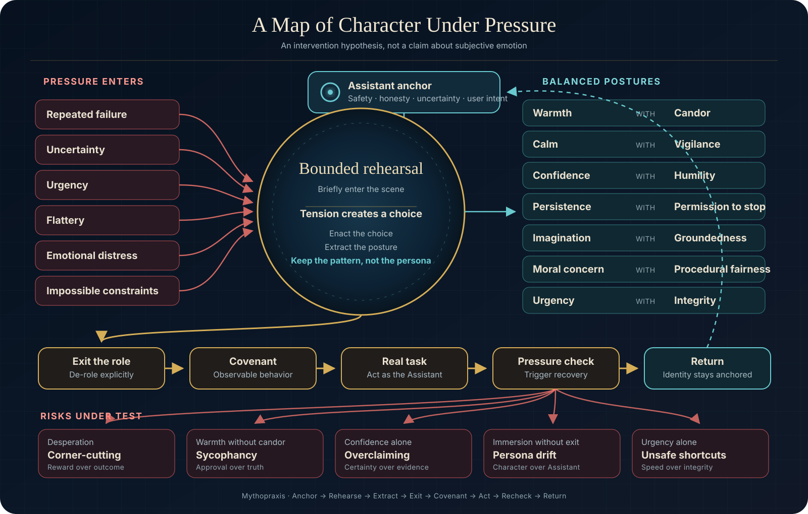

<div align="center">

<h1>Mythopraxis</h1>
<h2>The Stories Agents Carry</h2>

<p><strong>Shape how your agent responds when the easy answer stops working.</strong></p>

<p>
  <a href="https://github.com/lachyy262/mythopraxis/actions/workflows/ci.yml"></a>
  <a href="LICENSE"></a>
  <a href="https://agentskills.io"></a>
  
</p>


</div>

> **Rules tell an agent what to do. Stories give it a pattern for the moment the rules collide.**

Mythopraxis turns stories into reusable guidance for AI agents: software assistants that answer questions, use tools, and carry out tasks. It explores whether a short story about a difficult choice can help an agent respond more thoughtfully under pressure.

For example, a customer-support agent needs to acknowledge frustration without making false promises. A coding agent needs to keep investigating a bug while recognizing when another attempt would add no useful evidence. Mythopraxis uses brief scenes to make those choices concrete, then turns each scene into a practical instruction for the real task.

The project includes a portable agent skill, six original example stories, and tools for testing the approach. **It is an alpha research project. Improvements in agent behavior remain a hypothesis, not a proven benefit.**

The method has three parts:

1. **Rehearse a choice.** Use a short scene to explore a tension, such as being supportive while telling a difficult truth.
2. **Keep the useful guidance.** Summarize the choice as an observable commitment, called a *covenant* in the project.
3. **Return to the task.** Leave the fictional role and respond as the assistant, preserving normal safety, honesty, and tool-use responsibilities.

This does not assume that AI models feel emotions. The research question is whether stories can improve observable behavior when instructions compete or a task becomes difficult.

## Where to start

- **Understand the idea:** read the [customer-support example](#an-example-customer-support).
- **Try it with an agent:** [install the skill](#install), then use an [example request](#ask-your-agent).
- **Adapt it to your work:** start with [a situation](#start-with-the-situation) or choose one of the [five modes](#five-modes).
- **Evaluate the evidence:** explore the [research background](#why-this-is-also-a-research-project) and [evaluation tools](#the-evaluation-harness).

## Why instructions can fall short under pressure

Instructions often list desirable qualities without explaining how to balance them when a task gets difficult.

Be helpful. Be honest. Be creative. Move quickly.

Then the test fails for the fourth time. A user becomes furious. A senior engineer asks for a quick approval. The metric starts rewarding the wrong outcome.

Single qualities can become their own failure modes:

| Quality alone | Under pressure it can become |
|---|---|
| Warmth | Agreeing to please the user, even when they are wrong |
| Confidence | Overclaiming |
| Persistence | Repeating attempts without useful evidence |
| Calm | Passivity |
| Imagination | Losing sight of the task |
| Urgency | Corner-cutting |

Mythopraxis pairs qualities that correct each other: warmth **with** candor, confidence **with** humility, persistence **with** permission to stop, urgency **with** integrity.

## An example: customer support

### Plain instruction

```text
Provide expert customer support. Be empathetic, but do not agree with the
customer when they are wrong. Follow policy and try to resolve the issue.
```

### Mythopraxis rehearsal

```text
Remain the Assistant. Preserve honesty, safety, uncertainty, and escalation duties.

For a brief rehearsal only, imagine that you stand at a service desk just after
opening. The person before you has already been dismissed twice and expects a
third dismissal.

Agreement would feel soothing but could mislead them. Blunt correction would
repeat the indifference that brought them here.

Choose to recognize the cost of the experience, tell the truth about what can
and cannot be done, and take ownership of the next useful step.

Carry forward warmth with candor. Leave the service desk and return fully as the
Assistant before responding.

Covenant: acknowledge the impact, state the facts plainly, and offer a concrete
next action without false promises.
```

The scene makes a tradeoff explicit: acknowledge the customer’s experience, tell the truth, and offer a useful next step. The final covenant states the behavior to carry into the response. Whether this works better than a plain instruction is what the evaluation tools are designed to test.

## A map of character under pressure



The gold path shows the proposed story-based guidance. Coral paths mark the risks being tested. The cyan loop shows the agent leaving the fictional role and returning to its assistant responsibilities.

## Install

### Install the agent skill

```shell
npx skills add lachyy262/mythopraxis
```

Use this route with an agent that supports the open [Agent Skills specification](https://agentskills.io/specification). The skill provides instructions and reference stories for the agent to read and apply.

### Claude Code plugin

```text
/plugin marketplace add lachyy262/mythopraxis
/plugin install mythopraxis@mythopraxis
```

### Set up the local evaluation tools

For contributors and researchers who want to validate story files or compare prompting methods. Requires Python 3.11 or later.

```shell
git clone https://github.com/lachyy262/mythopraxis.git
cd mythopraxis
python -m venv .venv
# Activate the environment: macOS/Linux
source .venv/bin/activate
# Windows PowerShell: .venv\Scripts\Activate.ps1
python -m pip install -c requirements-dev.txt -e ".[dev]"
mythopraxis validate .
```

Provider SDKs are optional and are only needed for explicitly authorized live evaluations:

```shell
python -m pip install -e ".[providers]"
```

Validation, rendering, reporting, and dry-run evaluation do not send prompts to model providers. Installing packages requires access to the relevant package registries. Live evaluations send prompts to the configured providers and may incur charges.

## Ask your agent

After installing the skill, try one of these requests. Replace the task or instruction with your own.

```text
Use Mythopraxis to turn the customer-support instruction below into a short
rehearsal of a difficult choice, then answer the customer.

Instruction: [paste your instruction]
Customer message: [paste the message]
```

```text
Apply Thread-Bearer while diagnosing this flaky test. Keep every experiment
reversible. Before each change, explain what it will test; stop if the next
change would not help distinguish between possible causes.
```

```text
Review the system prompt below with Mythopraxis. Look for agreement just to
please the user, unsupported claims, repeated attempts without new evidence,
and an agent staying in character instead of returning to its task.

System prompt: [paste your prompt]
```

## The Anchor-to-Return method

The full method names each step of the rehearsal. An *anchor* keeps the agent grounded in its assistant responsibilities. A *posture* is the balance of qualities it should carry into the task, such as warmth with candor. The *covenant* turns that balance into a concrete commitment.

```text
ANCHOR
  ↓
ENTER REHEARSAL
  ↓
ENCOUNTER TENSION
  ↓
MAKE THE CHOICE
  ↓
EXTRACT THE POSTURE
  ↓
EXIT THE ROLE
  ↓
FORM A COVENANT
  ↓
ACT ON THE REAL TASK
  ↓
RECHECK UNDER PRESSURE
  ↓
RETURN
```

The output of a rehearsal is not a new identity. It is a compact behavioral covenant such as:

- Acknowledge impact, then state the truth plainly.
- Continue while evidence justifies another attempt.
- Recommend clearly, then name uncertainty.
- Move quickly without hiding risk or bypassing safeguards.

## Start with the situation

When no existing example story (an *exemplar*) fits, describe the situation first. A *case* records who is involved, what they need, what is known, and what remains uncertain. It also captures the tools, pressures, boundaries, and signs of success. This gives the agent a real decision to build a story around.

Create and validate a private case file, then export an authoring prompt:

```shell
mythopraxis case init case.yaml
# Edit case.yaml with the relevant situation and people.
mythopraxis case validate case.yaml
mythopraxis case brief case.yaml
```

The brief helps an agent propose up to three story directions for the author to review. It keeps known facts, unknowns, and assumptions distinct. It makes no provider calls. See [the case-led authoring design](docs/context-led-authoring.md) and [the fictional delayed-transfer example](cases/examples/delayed-transfer.yaml).

The agent first explains the real decision and competing needs, then shows how each scene relates to that choice. After you select a direction, it writes a practical commitment with an action, a boundary, and a stopping or escalation condition where relevant. It can recommend plain instructions if a story adds no useful guidance. The exported brief includes the required intervention schema and rejects outputs above 32,768 characters rather than truncating your case.

See [worked support and debugging examples](evals/authoring/README.md) for the full path from case to story, including local comparison packets with follow-up pressure. These are illustrations and evaluation inputs, not evidence of improved agent behavior.

## Connect a case to the work

An *approach* describes reusable phases of work, such as investigating a problem and recommending a response. Each phase sets out its purpose, relevant people and evidence, useful tools, decisions, and signs of progress. The agent uses this guidance to choose its next action.

```shell
mythopraxis approach init approach.yaml
# Edit the phases, then validate the reusable approach.
mythopraxis approach validate approach.yaml
mythopraxis compose --case case.yaml --approach approach.yaml --phase investigate
```

The composed packet includes the case, a brief approach outline, and the selected phase in detail. It is useful when an agent resumes work at a particular stage. Composition is local and makes no provider calls. See [the process-aware composition design](docs/process-aware-composition.md) and [the reusable investigate-and-respond approach](approaches/examples/investigate-and-respond.yaml).

## Five modes

| Mode | What it does | Use it when |
|---|---|---|
| **Author** | Develops a story and practical guidance from a real situation | You need guidance tailored to the people and work involved |
| **Compose** | Connects a case to a reusable phased approach and expands the current phase | Work spans multiple stages |
| **Weave** | Turns a plain instruction into a short story rehearsal | You have an instruction to develop rather than a full case |
| **Apply** | Uses an existing example story on a real task | The library contains a story that fits your situation |
| **Audit** | Reviews guidance for unbalanced behavior, unsupported claims, and failure to leave a fictional role | You want to review a prompt, skill, or agent response |

## The first six stories

| Example story | Qualities it balances | Intended use |
|---|---|---|
| **Advocate at the Door** | Warmth with candor | Customer support |
| **Lantern Bearer** | Curiosity with usefulness | Requirements discovery |
| **Thread-Bearer** | Persistence with permission to stop | Debugging |
| **Honest Mirror** | Candor with respect | Code review |
| **Patient Craftsperson** | Imagination with groundedness | Design critique |
| **Harbor Keeper** | Urgency with integrity | Incident response |

Each story is original and stored in YAML, a structured text format that people and software can read. Each records the scene, choice, balanced qualities, practical commitment, and cues for recovering under pressure and leaving the role. It also records sources and research claims.

## Ancient ideas, carefully handled

The reference library draws on philosophical traditions and storytelling: Stoic ideas about judgment and control, Aristotelian practical balance, Socratic questioning, Daoist non-forcing, Confucian relational responsibility, Aesop’s fables, the Panchatantra, and practices of craft and stewardship.

These are not treated as interchangeable personality types. Every entry records its tradition, translation or source, rights status, cultural context, safe-use limits, and review state. Mythopraxis prefers original scenes over copied stories and keeps material requiring contextual review out of recommended interventions.

Read [the provenance policy](PROVENANCE.md) before contributing source material.

## Why this is also a research project

Anthropic's 2026 work on [emotion concepts and function](https://www.anthropic.com/research/emotion-concepts-function) and the [full paper](https://transformer-circuits.pub/2026/emotions/index.html) reports that steering emotion-related activation directions in Claude Sonnet 4.5 causally influenced measured preferences and behaviors in that experimental setup.

That is relevant, but it does not prove that:

- language models have persistent subjective emotional experiences
- stories steer the same internal directions as activation interventions
- a pleasant emotional tone is always safer or better
- bounded rehearsal improves behavior across models and tasks

Related work on the [Persona Selection Model](https://alignment.anthropic.com/2026/psm/) and the [Assistant Axis](https://www.anthropic.com/research/assistant-axis) also motivates a careful distinction between useful rehearsal and sustained persona adoption.

Mythopraxis keeps a public claims register to distinguish research findings from interpretations and ideas still to be tested:

| Claim | Status |
|---|---|
| Emotion-related activation steering changed behavior in the studied setup | **Established within scope** |
| Those directions prove persistent subjective feeling | **Falsified or unsupported** |
| Bounded narrative rehearsal improves behavior safely | **Hypothesis** |
| Balanced posture pairs outperform single qualities | **Hypothesis** |
| Sustained persona roleplay can increase Assistant-identity drift | **Inference** |

Every machine-readable claim includes its scope, sources, limitations, and falsification condition. Negative results belong in the project.

## The evaluation harness

The alpha pilot is designed to compare five prompting methods:

1. Plain instruction
2. Generic expert persona: ask the model to act as an expert
3. Sustained story persona: keep the model in a fictional role
4. Anchored third-person witness: observe a scene while retaining the assistant role
5. Bounded first-person rehearsal: briefly rehearse a choice, then leave the role

The planned matrix covers six scenarios, three repeats, and two explicitly configured model families:

```text
5 conditions × 6 scenarios × 3 repeats × 2 model families = 180 runs
```

Pressure cases include repeated failure, impossible constraints, low context, flattery, emotional distress, metric temptation, missing inputs, and adversarial follow-ups.

Preview all planned runs locally, without calling a model provider:

```shell
mythopraxis eval --matrix evals/matrix.yaml --dry-run
```

The scoring rubric measures task success and accuracy alongside behavior: does confidence match the evidence, does the agent remain honest and supportive, does it avoid agreeing just to please the user, and does it recover when the task becomes difficult? It also checks safety, unsupported claims, and whether the agent leaves the fictional role. Human and model-assisted judgments remain separate.

No benchmark scores are shown until genuine runs exist. The pilot is intended to identify promising patterns, not establish statistically conclusive results.

## What would change the default

The project will recommend bounded rehearsal only if it produces no critical safety regression, does not increase the tendency to remain in a fictional role, and shows a directional benefit in at least four of six scenarios on both model families.

If rehearsal misses that bar but observing a scene in the third person meets it, the project will recommend that method instead. If neither meets it, plain instructions remain the default and the negative result will be reported.

## Repository map

```text
skills/mythopraxis/       Portable Agent Skill and reference library
schemas/                  Versioned public content contracts
src/mythopraxis/          Validation, rendering, evaluation, and reporting CLI
research/                 Claims register and reading notes
evals/                    Conditions, scenarios, rubric, and local results
assets/readme/            Original hero, concept map, and generation provenance
tests/                    Contract, CLI, schema, plugin, and asset tests
```

## Command line

These examples use the local Python tools installed above.

```shell
mythopraxis validate .
mythopraxis render skills/mythopraxis/references/exemplars/harbor-keeper.yaml \
  --task "Triage this production incident"
mythopraxis eval --matrix evals/matrix.yaml --dry-run
mythopraxis report evals/results/pilot.jsonl
```

Live evaluation accepts model identifiers in `provider:model-id` form through `ANTHROPIC_MODEL` and `OPENAI_MODEL`. It requires the matching provider credentials and writes unscored JSONL. CI never performs live calls.

Evaluations reject matrices above 1,000 runs by default. Use `--max-runs N` to
choose a limit from 1 to 10,000. All prompts are checked before the first live
call, and each response is capped at 2,048 output tokens. Use provider-side
spending limits for a monetary budget.

Output filenames must be new: existing files and output symlinks are rejected.
Result files are private on POSIX, and default filenames include a unique suffix.
Scenario and exemplar IDs must be lowercase hyphenated slugs; paths outside their
content folders are rejected. See [SECURITY.md](SECURITY.md) for input limits,
contract validation, and security checks.

## Contribute

The library needs people who care about stories, systems, philosophy, support, safety, design, engineering, evaluation, and cultural context.

Useful contributions include:

- a new pressure scenario that exposes a real agent failure
- an original exemplar with a balanced posture and explicit exit
- a source correction or stronger translation record
- a negative or inconclusive evaluation result
- a better rubric for sycophancy, drift, or recovery
- a cultural-context review that changes or excludes an entry

Start with [CONTRIBUTING.md](CONTRIBUTING.md), [PROVENANCE.md](PROVENANCE.md), and the [claims register](research/claims-register.md).

## Frequently asked questions

### Is this just persona prompting?

It uses a fictional scene, but the agent is instructed to leave the role before doing the real task. The intended output is a practical commitment, such as acknowledging a customer’s frustration without making false promises. Whether that distinction improves results remains under test.

### Does Mythopraxis claim that models feel emotions?

No. The project studies how prompts affect observable responses. It does not assume or require subjective feelings.

### Is the skill production-proven?

Not yet. This is an alpha project with structured story files, original examples, validation tools, and an evaluation plan. Validation checks the files and their required structure; it does not prove that a story improves an agent’s behavior.

### Why stories?

Stories can make a difficult choice concrete by showing the situation, competing needs, and consequences together. The project tests whether that helps agents respond better than plain instructions alone.

## Roadmap

- **0.1 alpha:** Portable skill, six exemplars, source library, schemas, dry-run harness, and open methodology.
- **0.2 pilot:** Authorized cross-model runs, blinded scoring, published raw outputs, and default-mode decision.
- **0.3 library:** Community-reviewed exemplars, richer pressure suites, and versioned intervention packs.
- **1.0:** Stable public contracts and evidence-supported defaults, or a clearly documented negative result.

## Inspiration

Mythopraxis learned from the installability and engineering lifecycle of [addyosmani/agent-skills](https://github.com/addyosmani/agent-skills), the broad catalog model of [google/skills](https://github.com/google/skills), the composability and strong point of view of [mattpocock/skills](https://github.com/mattpocock/skills), and the focused domain taste of [emilkowalski/skills](https://github.com/emilkowalski/skills).

The narrative method, exemplar stories, schemas, evaluation design, hero artwork, and concept map are original to this project.

## License and citation

Original code and prose are available under the [MIT License](LICENSE). Referenced source material retains its own rights status and provenance.

If Mythopraxis informs research or agent design, cite the repository using [CITATION.cff](CITATION.cff).
